# **TAREA MÓDULO 2.- Ejecutando y gestionando contenedores.**

Una vez tenemos iniciado docker, debemos descargarnos algunas imágenes mediante el comando  **docker pull** .  
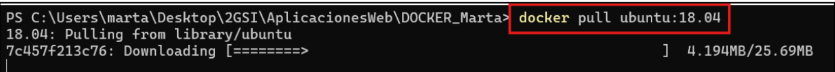

Para comprobar que todas las imágenes se han descargado correctamente, miraremos que se hace un listado con las imágenes descargadas con el comando docker images.  
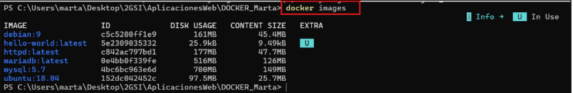

A continuación, con las imágenes ya descargadas vamos a iniciar un contenedor que tenga la imagen de ubuntu.  
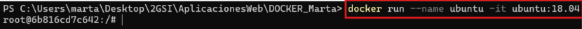
Nos salimos del contenedor y comprobamos que está inactivo con el comando **ps \-a**, ya que con este comando nos muestra los contenedores que están inactivos .  
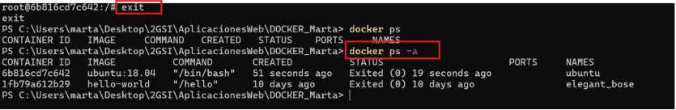

Volvemos a iniciar el contenedor y comprobamos que con el **docker ps** nos muestra los contenedores que están activos.  
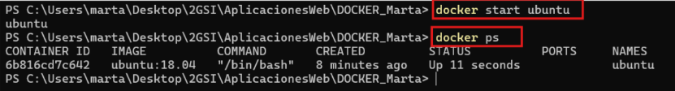

Mostraremos el contenido de /etc/os-releases sin entrar en el contenedor. Para ello usaremos el comando exec.¡¡¡IMPORTANTE \!\!\! el contenedor debe estar activo.

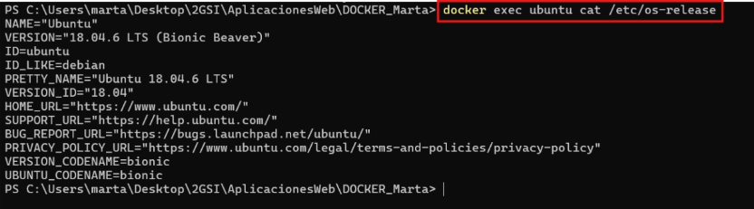 

Crearemos un nuevo contenedor de php que se llame web y pueda ser accesible por el puerto 8181\. 

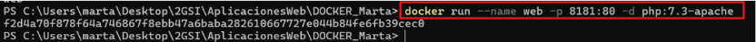

// El puerto 8181 será el puerto origen y el 80 será el de docker.//  
Comprobamos que está activo.

Vamos a crear 2 index , uno .html y otro .php .  
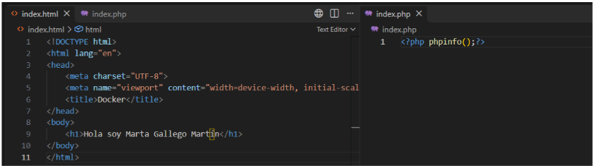

Para comprobar que los ficheros están creados, usamos el comando dir.

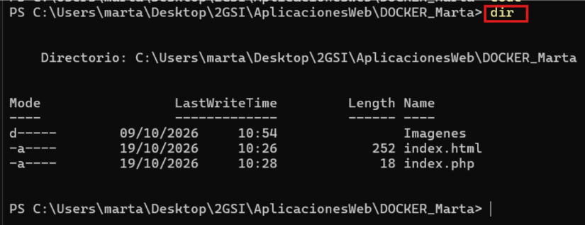

Pasamos los ficheros al contenedor.

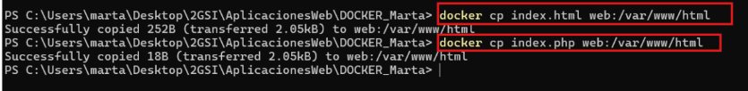

Comprobación de que se puede acceder :  
Desde el puerto 8181 debemos ver la información	de PHP.  
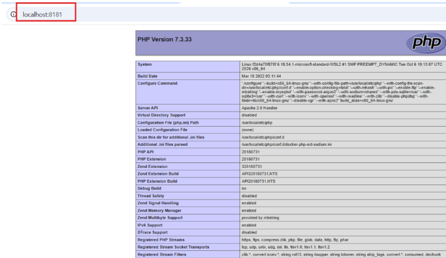

Ahora desde localhost:8181/index.html, deberemos ver el index.html que hemos visto anteriormente con nuestro nombre.  
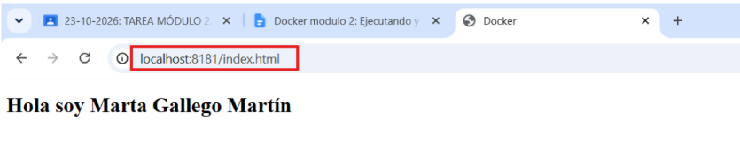

Vamos a crear otro contenedor que se llame bbdd  y tenga dentro la imagen de mariadb, debe estar en el puerto 3336\.  

Confirmamos que los contenedores anteriores están activos.  

Mostramos la ip y el rango de puertos  del contenedor web.  
Direccion Ip:  
![][image16]

Rango Puertos:  
![][image17]

Mostramos ip y rango de puertos de contenedor bbdd.

Dirección IP:  
![][image18]

Rango de puertos:  
![][image19] 

Comprobamos que podemos acceder de forma física y de forma virtual a la base de datos de mysql.

Forma Virtual:   
![][image20]

Forma Física:

![][image21]

